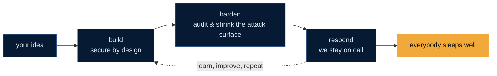

<!-- Org profile README · rendered at https://github.com/SecureCMD -->

<div align="center">


<a href="https://securecmd.com">
  
</a>

<br/>

[](https://securecmd.com)
[](https://securecmd.com/blog/index.html)
[](https://x.com/SecureCMD)
[](https://www.linkedin.com/company/secure-code-metadynamics)
[](https://securecmd.com/pgp-key.asc)

</div>

```text
   ███████╗ ██████╗███╗   ███╗██████╗
   ██╔════╝██╔════╝████╗ ████║██╔══██╗
   ███████╗██║     ██╔████╔██║██║  ██║   Secure Code MetaDynamics
   ╚════██║██║     ██║╚██╔╝██║██║  ██║   ~ small team, big on details ~
   ███████║╚██████╗██║ ╚═╝ ██║██████╔╝   loc: Spain, EU
   ╚══════╝ ╚═════╝╚═╝     ╚═╝╚═════╝    lang: en | es | it | pt
```

## `~/hello`

We're **SecureCMD**, a small software company from Spain that builds, hardens and looks after
software that really can't afford to break. Our day job is serious stuff — but we're developers
first, and we like to share the tools we write along the way.

Our favourite idea: **security shouldn't feel like a punishment.** Good defaults, readable code
and boring deploys make everybody's life easier (and we love boring deploys).

```diff
+ secure defaults, out of the box
+ code you can read, review and trust
+ signed builds & SBOMs, because "it works on my machine" isn't a supply chain
+ docs written by humans, for humans
- security theatre
- "we'll add auth later"
- passwords in plaintext. ever.
```

## `~/projects`

<table>
  <tr>
    <td width="33%" valign="top">
      <h3><a href="https://github.com/SecureCMD/tmux-opener"><code>tmux-opener</code></a></h3>
      <p>Your tmux sessions, one click away. A tiny native macOS app that opens local or SSH tmux sessions in iTerm.</p>
      
      
    </td>
    <td width="33%" valign="top">
      <h3><a href="https://github.com/SecureCMD/cobiserver"><code>cobiserver</code></a></h3>
      <p>Self-hosted KOReader sync server. Drop-in compatible, with a self-service account UI. Your reading progress, on your own box.</p>
      
      
    </td>
    <td width="33%" valign="top">
      <h3><a href="https://github.com/SecureCMD/libmitmpy"><code>libmitmpy</code></a></h3>
      <p>A Python playground for man-in-the-middle experiments. <em>“But won't somebody please think of the children's security?!”</em></p>
      
      
    </td>
  </tr>
</table>

> [!TIP]
> Found something useful? A star makes our day. Found a bug? An issue makes our code better. Both are welcome!

## `~/workflow`



We lean on open standards instead of reinventing them: **OWASP ASVS**, **NIST SSDF**,
**ISO/IEC 27001**, **ENS**, **NIS2** and **DORA**.

## `~/contact`

<details>
<summary><code>$ report --vuln</code> &nbsp;Found a security issue in one of our repos?</summary>
<br/>

Thanks for looking out for us! Please **don't open a public issue** — check our
[`security.txt`](https://securecmd.com/.well-known/security.txt) and send us an encrypted note with our
[PGP key](https://securecmd.com/pgp-key.asc):

```text
C240 53A5 A5F7 200C 4772  DDE5 8EBD B4BC C144 98D2
```

We'll get back to you quickly, keep you in the loop, and credit you if you'd like.

</details>

<details>
<summary><code>$ ping securecmd</code> &nbsp;Want to work with us, or just say hi?</summary>
<br/>

Drop by [securecmd.com](https://securecmd.com), read the [blog](https://securecmd.com/blog/index.html),
or ping us on [X](https://x.com/SecureCMD). PRs, ideas and memes are all accepted
(the memes go through code review too).

</details>

<div align="center">

<br/>

<sub><code>// made with coffee, git rebase -i and a healthy amount of paranoia in Spain</code></sub>


</div>
